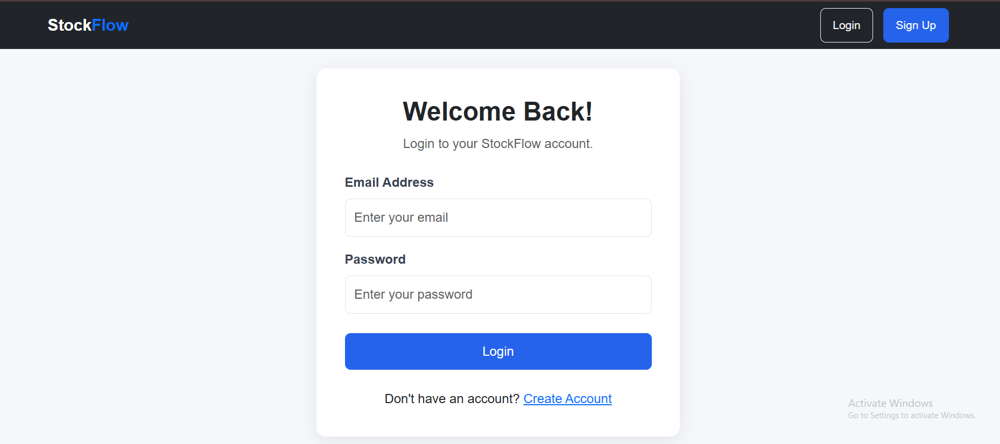

# StockFlow – Inventory Management System

StockFlow is a web-based inventory management application developed using Python and Flask. It helps organizations manage products, monitor stock levels, track inventory, and identify low-stock products through a centralized dashboard.

The application uses SQLite for local development and PostgreSQL for production deployment. It is deployed on Render.

## Features

### User Authentication
- User registration and login
- Secure password hashing
- Organization creation during signup
- Protected application routes
- Logout functionality

### Product Management
- Add new products
- View all products
- Edit product details
- Delete products with confirmation
- Search products by name or SKU
- Organization-specific SKU uniqueness

### Dashboard Analytics
- Total number of products
- Total available inventory quantity
- Low-stock product count
- Low-stock products table
- Organization information

### Inventory Monitoring
- Configurable low-stock thresholds
- Automatic stock status identification
- In Stock, Low Stock, and Out of Stock labels

### Security
- Password hashing
- Flask-Login authentication
- CSRF protection
- Organization-level product data isolation
- Input validation

## Technologies Used

| Technology | Purpose |
|---|---|
| Python | Backend programming |
| Flask | Web framework |
| PostgreSQL | Production database |
| SQLite | Local development database |
| Flask-SQLAlchemy | Database ORM |
| Flask-Login | User authentication |
| Flask-WTF | CSRF protection |
| psycopg | PostgreSQL database driver |
| Gunicorn | Production WSGI server |
| HTML5 | Page structure |
| CSS3 | Styling |
| Bootstrap 5 | Responsive UI |
| JavaScript | Frontend interactions |
| Git and GitHub | Version control |
| Render | Cloud deployment |

## Project Structure

```text
stockflow-inventory-management/
│
├── app.py
├── config.py
├── models.py
├── requirements.txt
├── .env.example
├── .gitignore
├── README.md
│
├── templates/
│   ├── base.html
│   ├── login.html
│   ├── signup.html
│   ├── dashboard.html
│   ├── products.html
│   ├── add_product.html
│   └── edit_product.html
│
├── static/
│   ├── css/
│   │   └── style.css
│   ├── js/
│   └── images/
│
└── instance/
```

## Installation and Setup

### 1. Clone the repository

```bash
git clone https://github.com/Srilatha-1232/stockflow-inventory-management.git
```

### 2. Open the project folder

```bash
cd stockflow-inventory-management
```

### 3. Create a virtual environment

```bash
python -m venv venv
```

### 4. Activate the virtual environment

Windows PowerShell:

```powershell
.\venv\Scripts\Activate.ps1
```

### 5. Install dependencies

```bash
pip install -r requirements.txt
```

### 6. Configure Environment Variables

Create a `.env` file in the project root directory.

Add the following variables:

```text
SECRET_KEY=your-strong-secret-key
DATABASE_URL=your-local-database-url
SESSION_COOKIE_SECURE=False
```

For local development, SQLite is used by default if DATABASE_URL is not configured.

For production deployment, configure SECRET_KEY, DATABASE_URL, and SESSION_COOKIE_SECURE=True in the Render environment settings.

Never commit your `.env` file or expose your secret keys or database credentials.

### 7. Run the application

```bash
python app.py
```

Open your browser:

```text
http://127.0.0.1:5000
```

The application initializes its SQLite database when it starts.

## Database Models

- **Organization:** Stores organization details and default low-stock threshold.
- **User:** Stores user email, organization relationship, and hashed password.
- **Product:** Stores product name, SKU, description, quantity, prices, and stock threshold.

## Data Isolation

StockFlow associates products with an organization. Product listing, editing, and deletion are restricted to the authenticated user's organization.

## Future Enhancements

- Inventory reports and data visualization
- Export inventory to Excel and PDF
- Product categories
- Stock movement history


## Author

Developed as a Python Full Stack Web Development project.

## Live Application

**Live URL:** https://stockflow-3dgw.onrender.com

**Deployment Platform:** Render

**Production Database:** PostgreSQL

## Application Screenshots

### 1. Login Page


### 2. Dashboard


### 3. Product Management


## GitHub Repository

[StockFlow – Inventory Management System](https://github.com/Srilatha-1232/stockflow-inventory-management)

## License

This project is developed for educational and assessment purposes.